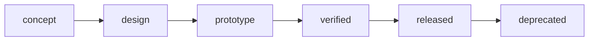

# Board documentation

This folder is the board's documentation. Start with the sections a reader needs first and grow it with the design.

| Page | What it covers |
| --- | --- |
| [Evidence pack](evidence-pack.md) | What a release gives an integrator, and the supplier tiers |
| `adr/` | Decisions and why: chip choice, MCU choice, variants, licence. Copy [`adr/0000-template.md`](adr/0000-template.md) |
| `errata.md` | Known anomalies for each revision (create it with the first one) |

## Lifecycle

| Status in `board.yml` | Means | Gate to leave it |
| --- | --- | --- |
| `concept` | Needs and first requirements | Needs accepted; chip and host choice recorded in an ADR |
| `design` | Schematic, layout, enclosure in work | Requirements approved; schematic review done; trace check clean |
| `prototype` | Boards built and being tested | Verifications planned for every approved requirement |
| `verified` | Tests passed with evidence | No failed or unverified requirement without a waiver |
| `released` | Signed tag, evidence pack, release package | Release checklist in `manufacturing/README.md` |
| `deprecated` | Superseded or end of life | Notice in `CHANGELOG.md` and `docs/errata.md` |

A person signs off each gate. An agent may draft the work; a pull request review by someone who did not write it is
what moves a status.
